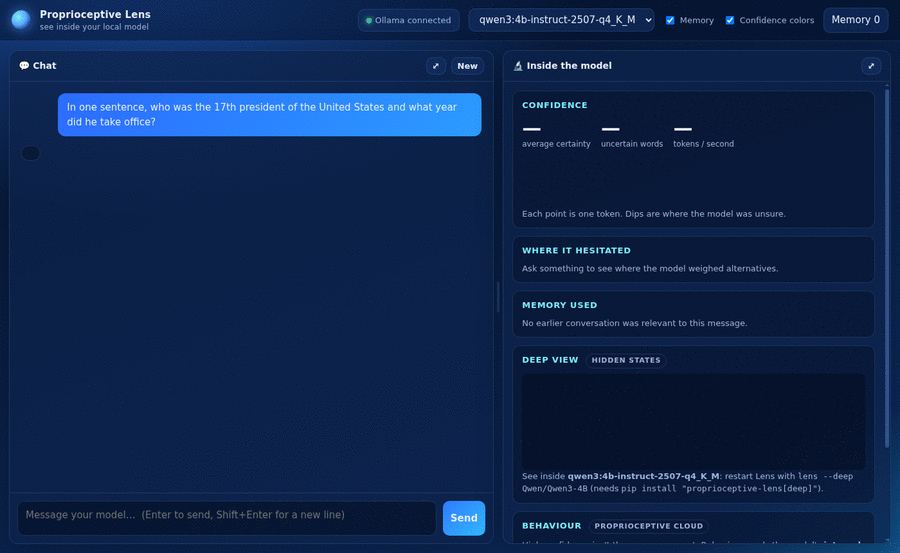
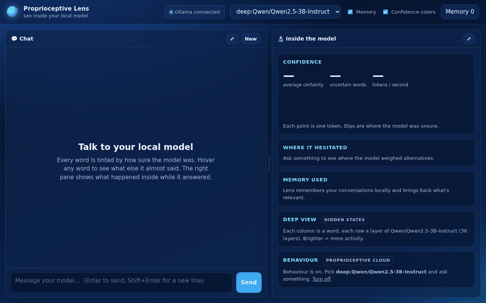

# Proprioceptive Lens

**Your local model is wrong more often than it sounds. Lens shows you where, and checks.**

[](https://pypi.org/project/proprioceptive-lens/)
[](https://pypi.org/project/proprioceptive-lens/)
[](https://github.com/Loganwins/ProprioceptiveAI/blob/main/docs/MODELS.md)
[](#license)

A free app for anyone running local AI with [Ollama](https://ollama.com) or Hugging Face. One command, no account, no
dependencies, and nothing you type leaves your computer.

```text
You:   In what year was Albert Einstein born? Answer with just the year.
Model: 1904            ← Lens: "190" was only 66% sure
Lens:  Double-check → "Albert Einstein was born in 1879."   ✗ the answers disagree
```
*A real run on Llama 3.2 1B (unedited output from Lens's own test set).*

```bash
pip install proprioceptive-lens && lens
```

## What you get

| | What it does | Evidence |
|---|---|---|
| **Certainty on every word** | Each word is tinted by how sure the model was. Hover to see what it almost said. | Read straight from the model's own probabilities |
| **Double-check** | A short answer with a shaky word gets re-asked in full, and Lens tells you if the answer changes. | Short factual questions: Llama 3.2 1B **68.6% → 91.2%** correct, Qwen2.5 0.5B 77.5% → 87.9%, Qwen2.5 1.5B 93.8% → 99.0%, Llama 3.2 3B 96.4% → 98.7%. Passed on all 4 models tested. |
| **See inside** (deep mode) | A live layer-by-layer map of the network while it writes. | Runs the model's open weights on your machine |
| **Behaviour** (opt-in) | Internal-state readings: code or prose, repeating itself, creative or literal, assertive or hedged, asking or stating. | On realistic prompts across 16 popular models, the bars you see lean the right way **77%** of the time and the wrong way 8%. A bar that can't read a model reliably is hidden for that model. |
| **Steering** (Deluxe) | Sliders that push the model's internal state while it writes, with a before/after. | **81 models, 184 directions**, each tested on its own model against random pushes. The most popular models also pass a long-answer safety check. |
| **Private memory** | Remembers your conversations across chats, on your computer, for any model. | Local SQLite file you can view or delete |
| **For agents** | `lens mcp` lets Claude Code, Cursor or Claude Desktop ask your local model and see how sure it was. | Claude Code plugin included |

## What it can't do (read this)

- **Confident mistakes.** Word probabilities can't catch a model that is wrong *and* sure. Example: `qwen3:4b` says the
  17th US president was Garfield at 100% certainty (it was Andrew Johnson). Double-check catches *shaky* answers, not
  these.
- **Behaviour bars are readings, not proof.** They're right about three times in four on real prompts, not always.
- **Steering is user-controlled on purpose.** Nothing steers automatically. Directions that made long answers worse
  were withdrawn, and sliders stop at the strongest setting that passed.





## Install and run

```bash
pip install proprioceptive-lens      # no dependencies; Python 3.9+
ollama pull qwen3:4b                 # any chat model works
lens                                 # opens the app in your browser
```

Lens opens in its own app window (using Chrome, Edge, Chromium or Brave if you have one; otherwise your browser).
Add it to your apps menu with `lens install`; use `lens --tab` for a normal browser tab.

Options: `lens --port 7777 --ollama http://127.0.0.1:11434 --hindsight http://localhost:8888`.

## Deep mode and Behaviour

```bash
pip install "proprioceptive-lens[deep]"
lens --deep Qwen/Qwen2.5-3B-Instruct
```

Already chatting with an Ollama model? Press **See inside** in the app. Lens loads the same model's open weights
and switches you into deep mode, with no restart. Or start Lens with `--deep <model>` as above.

Deep mode runs a Hugging Face model locally and reads its hidden states. It works with Llama, Qwen, Mistral, Gemma,
Phi, Falcon, Granite, OLMo, SmolLM, DeepSeek and other families. Lens tells Ollama users which command matches the
model they already run. Switch on **Behaviour** in the app to see internal-state probe scores. The app lists which
models have a Behaviour pack; so does [docs/MODELS.md](https://github.com/Loganwins/ProprioceptiveAI/blob/main/docs/MODELS.md).

## Lens Deluxe: steer the model from the inside

Behaviour shows what the model is doing. Deluxe lets you change it while it writes. A slider per behaviour
(more or less formal, more or less repetitive, and others) pushes the model's internal state in that direction,
and **Before / after** re-runs your question without steering so you can see exactly what changed.

- Every steering direction is tested on each model before it is offered. It has to change the model's writing more
  than random pushes of the same size do. It also has to keep the text fluent, add no refusals and stay on topic.
  Sliders stop at the strongest setting that passed.
- On the most popular models, long answers are checked too: a direction that makes 300-word answers more repetitive
  is capped or withdrawn. Elsewhere, sliders stay at the gentlest strength that passed until that check has run.
- **New: Answer in French** (Qwen2.5 3B, app 0.1.9+). Steers the model's internal state toward French with no
  instruction in your prompt. In testing, 8 plain English questions went from 8% to 99% French at one step of the
  slider, while a random push of the same size stayed at 1–2%.
- Nothing steers automatically. You choose, and you can always compare against the unsteered answer.
- Same privacy as Behaviour: your text never leaves your computer.

**Truth check** (Deluxe). A local reader model reads factual claims, including claims from Claude or any
other assistant, and Proprioceptive AI's internal-state probe returns a fabrication-risk reading for each:
low, elevated or high. It catches **blatant mismatches** in factual relations: who wrote what, capitals, landmarks, currencies,
discoveries, chemical symbols. On claims where an unrelated real answer was swapped in, "high" flagged about 57% with
about 2.5% false alarms. It does **not** catch plausible-sounding errors (for example a neighbouring country's currency,
or a common misconception), and it doesn't handle numbers or dates. Treat "low" as "no red flag", never as
confirmation. Your claims are read on your computer.
Available in the app API (`/api/claims`) and to Claude through `lens mcp` (`check_claims`).

Start the 7-day free trial from the Steer panel; no card is needed. Enter your email, then paste the activation token
you receive. Deluxe also removes the daily Behaviour limit.

## Proprioceptive Terminal Mode

```bash
lens term                                   # interactive: confidence-coloured output, /why, /memory, /behaviour
lens term -m qwen3:4b "your question"       # one-shot
echo "your question" | lens term --json     # JSON-lines events for scripts and pipelines
```

Events: `memory`, `token` (`text`, `p`, `alternatives`, plus `layers` in deep mode), `behaviour` (score per probe),
`done`. Any OpenAI-compatible client pointed at `http://127.0.0.1:7777/v1` also gets Lens memory.

## Use it from Claude Code, Cursor and other agents

**Claude Code plugin** (MCP server + a skill that teaches Claude when to ask your local model and how to read its certainty):

```
/plugin install proprioceptive-lens --marketplace Loganwins/ProprioceptiveAI
```

(Needs `pip install proprioceptive-lens` first. On older Claude Code: `/plugin marketplace add Loganwins/ProprioceptiveAI`
then `/plugin install proprioceptive-lens@proprioceptive-ai`.)

Or add just the MCP server: `lens mcp` runs Lens as an MCP server.

```bash
claude mcp add lens -- lens mcp            # Claude Code
```

Claude Desktop: add `{"mcpServers": {"lens": {"command": "lens", "args": ["mcp"]}}}` to `claude_desktop_config.json`
(use the full path from `which lens` if Desktop can't find it).

For Cursor or another client, add a stdio server with command `lens` and argument `mcp`. Tools:
- `ask_local_model`: the answer, its overall certainty, and the words the model hesitated on, with what it almost said
  (plus Behaviour scores in deep mode);
- `list_local_models`;
- `search_memory`.

## Share a prompt

`http://127.0.0.1:7777/?ask=Why%20is%20the%20sky%20blue` opens Lens with the prompt ready to send.

## Privacy

Lens listens only on `127.0.0.1` and rejects requests from other websites. Memories live in
`~/.proprioceptive-lens/memory.sqlite3`. You can view or forget them in the app, or delete the file. Behaviour is off
until you turn it on.

## License

MIT for this client. The Behaviour probes and the scoring service are proprietary to Proprioceptive AI, are not part
of this package, and no licence to them (or to any Proprioceptive AI patent) is granted by this licence.
